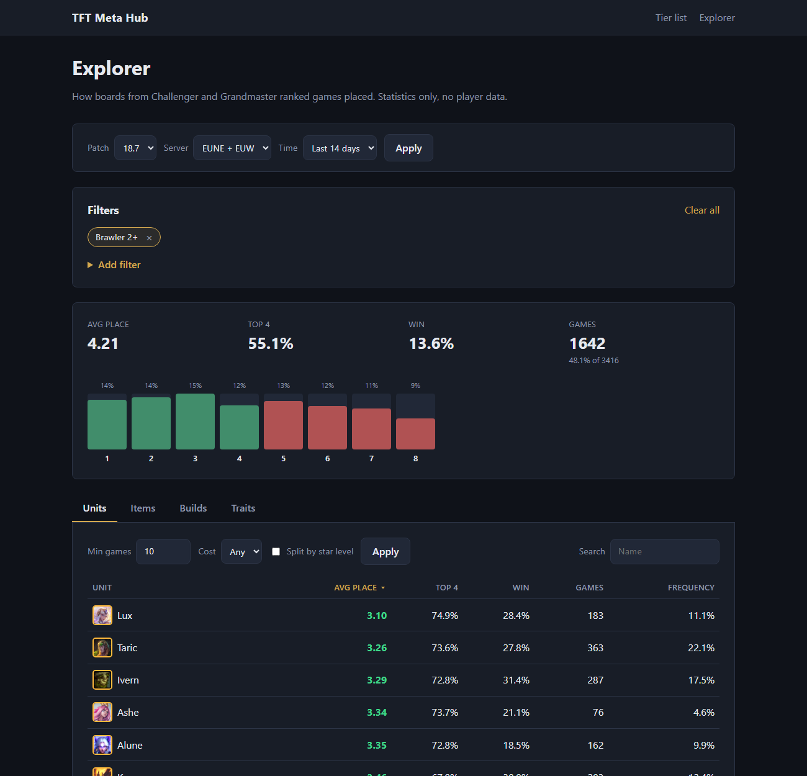
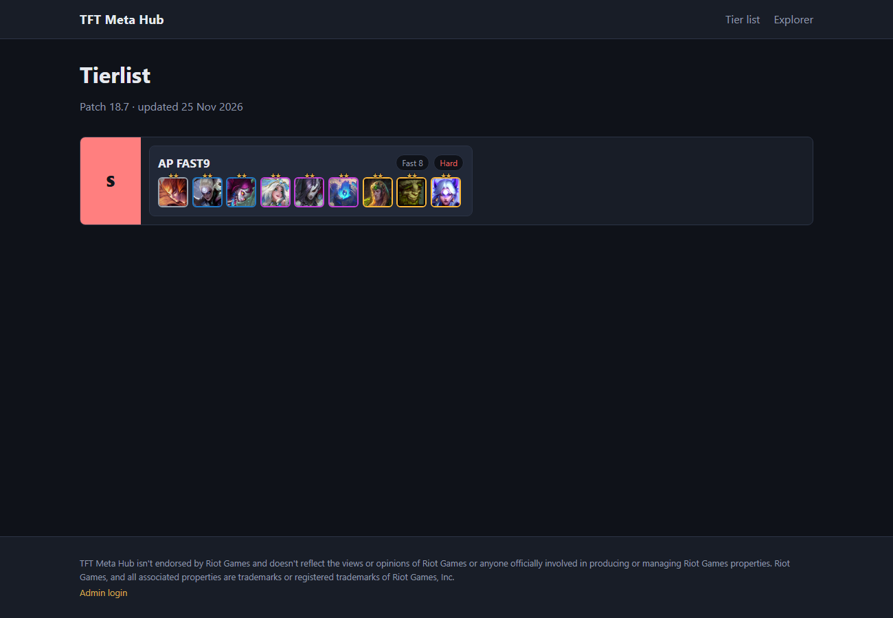
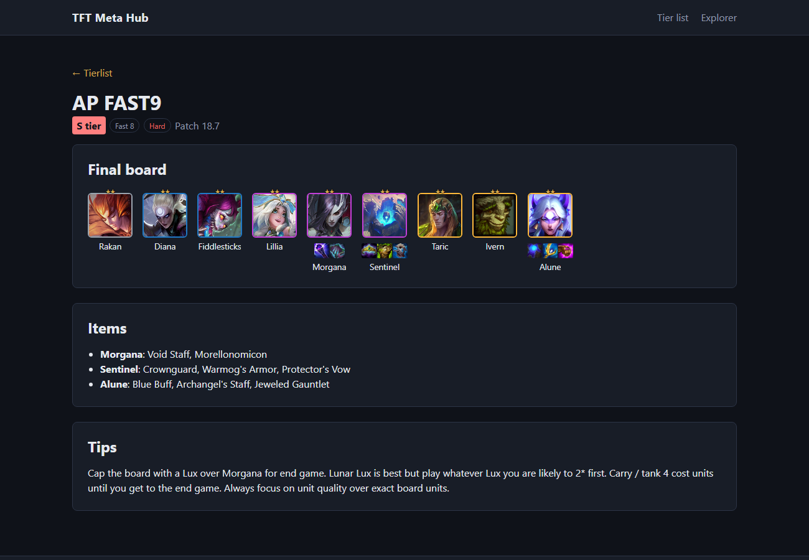
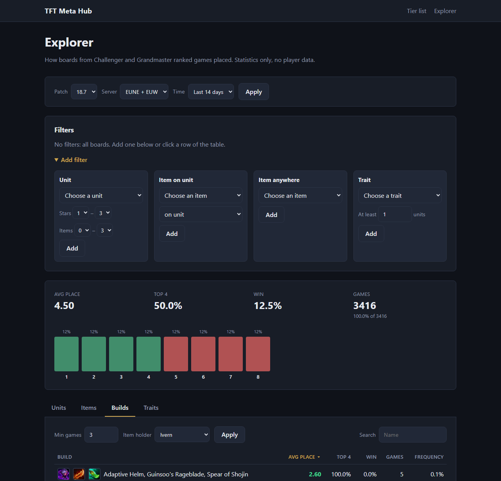

# TFT Meta Hub

A web application for **Teamfight Tactics** players with two parts:

- **Tier list** – an admin builds tier lists of team compositions for each patch and publishes them.
- **Explorer** – statistics of Challenger and Grandmaster ranked games collected from the Riot Games API
  (EUNE and EUW). It shows how boards with chosen units, items and traits placed: average placement, top 4 rate,
  win rate and number of games.

It is a server-side rendered Spring Boot application, built as a portfolio project while learning Java and Spring.



| Tier list | Composition | Explorer – builds |
|---|---|---|
|  |  |  |

## Features

- **Game data import** – champions, traits and items of a set from [Community Dragon](https://communitydragon.org),
  idempotent (importing again updates existing records).
- **Tier lists** (admin panel) – compositions in tiers S / A / B / C / Situational with units, star levels, carries,
  items, play style, difficulty and tips; "copy to new patch"; only one tier list is published at a time.
- **Match collector** – reads the Challenger and Grandmaster ladders, downloads new ranked matches of the current set
  in the background ("Collect now" button or an optional schedule) and deletes matches older than 14 days.
- **Explorer** – filters combined with AND (unit with star and item ranges, item on a unit, item anywhere, trait with
  a minimum number of units), a summary with a placement chart and four tables: **Units** (optionally split by star
  level), **Items** (optionally on one unit), **Builds** (three-item builds of one unit) and **Traits**.
  Tables can be sorted and searched, and clicking a row adds it as a filter. The whole state is in the URL, so
  every view can be shared as a link.

## Tech stack

Java 21, Spring Boot 4 (Web MVC, Security, Data JPA, JDBC, Validation), Thymeleaf, PostgreSQL, Flyway, Lombok,
`RestClient` + Jackson, JUnit 5, AssertJ, Mockito, `MockRestServiceServer`, Testcontainers, Docker Compose,
GitHub Actions. The frontend is plain HTML, CSS and a little vanilla JavaScript.

## Architecture

The code is organised **by feature**:

| Package | Responsibility |
|---|---|
| `gamedata` | Community Dragon client, import of champions / traits / items, patches entered by the admin |
| `tierlist` | tier lists and compositions: domain model, admin pages, public pages |
| `riot` | Riot API client, per-host rate limiter, response DTOs |
| `collector` | background collection of matches, retention, collector status |
| `explorer` | filters, SQL statistics queries, explorer page |
| `security` | form login for the single admin user |
| `web` | layout, home page, admin dashboard |
| `common` | shared beans (`Clock`) |

```
Browser ──> Controllers (thin) ──> Services ──> JPA repositories (tier lists, game data)
                                       │   └──> NamedParameterJdbcTemplate (explorer statistics)
                                       └──> RestClient ──> Riot API / Community Dragon
```

## Design decisions

- **Controllers stay thin; services return records.** Pages are rendered with Thymeleaf, but no service returns
  anything web-specific. A REST API with an Angular frontend could reuse the same services unchanged.
- **Rich domain model where there is behaviour.** For example, publishing a tier list archives the previously
  published one, and the composition checks its own rules (1–10 units, at most 3 items per unit).
- **Own rate limiter for the Riot API.** A development key allows 20 requests per second and 100 per 2 minutes,
  counted separately for every routing host. The limiter is a sliding window log per host (the times of recent
  requests), is thread-safe and takes a `Clock`, so tests control time. On HTTP 429 the client waits for `Retry-After`; on 401/403 the collection
  run stops with a clear log message instead of retrying with a dead key.
- **API results as a sealed interface.** `RiotApiResult` is `Success`, `NotFound`, `RateLimited`, `KeyInvalid` or
  `Failure`,
  handled with pattern matching for `switch`, so the compiler checks that every case is handled.
- **Statistics are aggregated in SQL.** The explorer builds its query from fixed SQL fragments: a common table
  expression selects boards of the patch, server and time range, every filter adds one `EXISTS` condition, and
  `GROUP BY` with `COUNT` / `AVG` computes each table in the database. Values are always named parameters and never
  concatenated into SQL. Indexes for these queries are added in a Flyway migration.
- **The URL is the state.** Every explorer setting is a GET parameter (filters as `f=unit:TFT18_Ahri:2-3:0-3`),
  so links can be shared, "back" works, and invalid values in an edited link fall back to defaults.
- **Player privacy.** Only aggregated statistics are stored and shown. No player names or Riot IDs are saved; PUUIDs
  are kept only in the collector's own table (to know when a player was last checked) and never reach the UI.
- **Schema only through Flyway** (`ddl-auto=validate`); `java.time.Clock` is injected instead of calling
  `Instant.now()`, so time-dependent code is testable.

## Running locally

Requirements: Java 21 and Docker. Copy `.env.example` to `.env` and fill it in. A Riot development key from
[developer.riotgames.com](https://developer.riotgames.com) is only needed to collect matches.

**Everything in containers:**

```bash
docker compose up --build
```

**Database in Docker, application from the IDE or Maven** (the application reads `.env` itself):

```bash
docker compose up -d postgres
./mvnw spring-boot:run          # Windows: .\mvnw.cmd spring-boot:run
```

Open <http://localhost:8080>. Admin panel: <http://localhost:8080/admin> (credentials from `.env`).

First steps in the admin panel:

1. Import the game data of the current set (e.g. `18`).
2. Add the current patch with its start date. Riot match data has no patch number, so a match belongs to the patch
   that was live when it was played.
3. Click **Collect now** to collect up to 300 matches.

## Tests

```bash
./mvnw verify
```

The suite contains unit tests (domain logic, rate limiter, filter parsing, statistics), web tests with `MockMvc` and
the real security configuration, and integration tests against PostgreSQL in Testcontainers. These include explorer
queries checked against a small data set with expected values computed by hand. Tests never call the Riot API or
Community Dragon; they use small, anonymised JSON fixtures. GitHub Actions runs the whole suite on every push.

## Legal

TFT Meta Hub isn't endorsed by Riot Games and doesn't reflect the views or opinions of Riot Games or anyone
officially involved in producing or managing Riot Games properties. Riot Games, and all associated properties are
trademarks or registered trademarks of Riot Games, Inc.
